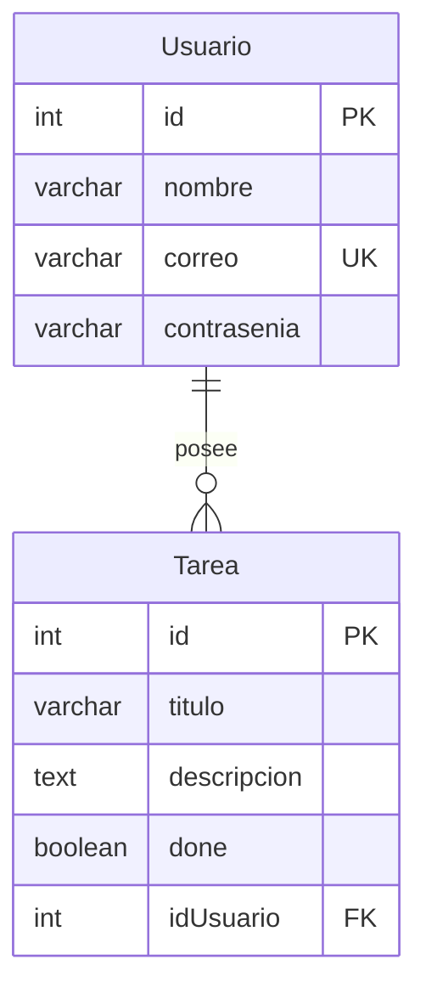

# 📋 Sistema de Gestión de Tareaa

Proyecto full-stack en desarrollo para la gestión de tareas multiusuario con autenticación basada en tokens JWT, persistencia en MariaDB contenedorizada con Docker y backend estructurado en Node.js / Express bajo el estándar ECMAScript Modules (ESM).

---

## 🚀 Arquitectura General del Proyecto

El repositorio está organizado en una arquitectura modular que separa la infraestructura de base de datos, el servidor API y el cliente web:

```text
mariaDbPractica/
├── 🐳 docker/          # Infraestructura contenerizada (MariaDB)
├── ⚙️ backend/         # API  con Express, MySQL2, JWT y Bcrypt
├── 💻 frontend/        # Aplicación cliente (en desarrollo)
└── 📄 README.md        # Documentación general del sistema
```

---

## 🛠️ Tecnologías y Herramientas

- **Entorno de ejecución:** Node.js (ES Modules, `"type": "module"`)
- **Gestor de paquetes:** `pnpm`
- **Framework web:** Express 5.x
- **Base de Datos:** MariaDB 11+ ejecutada en Docker
- **Conector BD:** `mysql2/promise` (Pool de conexiones asíncronas)
- **Seguridad:**
  - `bcrypt` para hashing seguro de contraseñas.
  - `jsonwebtoken` (JWT) para generación y validación de tokens de sesión.
- **Configuración y Entorno:** `dotenv`
- **Contenedores:** Docker & Docker Compose

---

## 📦 Estructura del Backend

El backend sigue un patrón arquitectónico en capas para desacoplar responsabilidades:

```text
backend/
├── src/
│   ├── app.js                    # Inicialización y arranque del servidor
│   ├── config/
│   │   └── config.js             # Mapeo de variables de entorno (.env)
│   ├── controller/
│   │   ├── login.controller.js   # Lógica de login y generación de JWT
│   │   ├── Tarea.controller.js   # CRUD de tareas asociadas al usuario autenticado
│   │   └── Usurios.controller.ts # Controlador de usuarios (en desarrollo)
│   ├── db/
│   │   ├── db.js                 # Pool de conexiones a MariaDB
│   │   ├── schema.sql            # Script DDL de tablas (Usuario, Tarea)
│   │   └── seed.js               # Script para datos iniciales de prueba
│   ├── middleware/
│   │   └── auth.middleware.js    # Verificación de Bearer Token en cabeceras
│   ├── models/
│   │   ├── tareas.js             # Consultas SQL (Data Access Object) de Tareas
│   │   └── usuarios.js           # Consultas SQL (Data Access Object) de Usuarios
│   ├── routes/
│   │   ├── index.js              # Enrutador central (/api)
│   │   ├── login.route.js        # Rutas de autenticación (/api/login)
│   │   └── tarea.route.js        # Rutas de tareas (/api/tareas)
│   └── services/
│       ├── encriptar.service.js  # Servicio de hash y comparación con Bcrypt
│       ├── express.service.js    # Wrapper OOP para Express y middlewares
│       └── jwt.service.js        # Generación y verificación de JWT
├── .env                          # Variables de entorno locales
├── package.json
└── pnpm-lock.yaml
```

---

## 🗄️ Modelo de Base de Datos

El esquema se compone de dos tablas con integridad referencial:



- **`Usuario`**: Almacena credenciales de usuario con contraseña cifrada y correo único.
- **`Tarea`**: Representa cada tarea vinculada a un `Usuario` mediante clave foránea con borrado en cascada (`ON DELETE CASCADE`).

---

## 🔐 Autenticación y Flujo de Trabajo

1. **Inicio de sesión (`POST /api/login`)**:
   - El cliente envía correo y contraseña.
   - El sistema busca el usuario por correo y valida la contraseña con `bcrypt.compare`.
   - Si es válido, emite un token JWT con vigencia de 2 horas que contiene `{ id, correo }`.
2. **Acceso protegido (`auth.middleware.js`)**:
   - Las peticiones a `/api/tareas` requieren la cabecera:
     ```http
     Authorization: Bearer <TU_TOKEN_JWT>
     ```
   - El middleware verifica la firma y validez del token y adjunta el payload en `req.data`.
   - Cada consulta o modificación de tareas restringe el acceso al `idUsuario` del token.

---

## 📡 Endpoints de la API

La API se encuentra prefijada en `/api`:

### 1. Estado de la API
| Método | Endpoint | Autenticación | Descripción |
| :--- | :--- | :--- | :--- |
| `GET` | `/api/` | No | Comprobación de salud (devuelve `ok`). |

### 2. Autenticación
| Método | Endpoint | Autenticación | Payload | Respuesta |
| :--- | :--- | :--- | :--- | :--- |
| `POST` | `/api/login` | No | `{"correo": "...", "contrasenia": "..."}` | `{"usuario": "ok", "token": "..."}` |

### 3. Tareas
| Método | Endpoint | Autenticación | Descripción |
| :--- | :--- | :--- | :--- |
| `GET` | `/api/tareas` | `Bearer Token` | Lista las tareas del usuario logueado con sus datos. |
| `GET` | `/api/tareas/:id` | `Bearer Token` | Obtiene una tarea específica si pertenece al usuario. |
| `POST` | `/api/tareas` | `Bearer Token` | Crea una nueva tarea asociada al usuario. |
| `PATCH` | `/api/tareas/:id` | `Bearer Token` | Actualiza título y descripción de la tarea. |
| `POST` | `/api/tareas/completar/:id` | `Bearer Token` | Marca una tarea como finalizada (`done = true`). |

---

## ⚙️ Guía de Puesta en Marcha

### 1. Requisitos Previos
- [Node.js](https://nodejs.org/) (versión 18 o superior)
- [pnpm](https://pnpm.io/)
- [Docker & Docker Compose](https://www.docker.com/)

### 2. Levantar la Base de Datos con Docker
Desde la raíz del proyecto:
```bash
cd docker
docker compose up -d
```
> MariaDB quedará disponible en el host en el puerto **`3307`** (redirigido internamente al `3306`), con usuario `root` y base de datos `tareas`.

### 3. Configurar Variables de Entorno
Crea o revisa el archivo `backend/.env`:
```env
PORT_SERVER=3000
PORT_DB=3307
HOST_DB=localhost
USER_DB=root
PASSWORD_DB=
PALABRA_SECRETA=TuClaveSecretaSuperSegura
SALT_ROUNDS=10
```

### 4. Instalar Dependencias y Poblar la Base de Datos
Desde la carpeta `backend`:
```bash
cd ../backend
pnpm install

# Ejecutar el seed para crear usuarios de prueba y tareas iniciales:
node src/db/seed.js
```

### 5. Iniciar el Servidor en Desarrollo
```bash
pnpm run dev
```
El servidor arrancará escuchando peticiones en el puerto configurado (ej. `http://localhost:3002/api`).

---

## 👥 Datos de Prueba (Seeds)

El script `seed.js` crea los siguientes usuarios de prueba:

| Usuario | Correo | Contraseña |
| :--- | :--- | :--- |
| Juan Pérez | `juan@correo.com` | `123456` |
| María Gómez | `maria@correo.com` | `abcdef` |

---

## 📌 Estado Actual y Próximos Pasos

- [x] Contenedor Docker para MariaDB configurado.
- [x] Conexión mediante Pool asíncrono con `mysql2/promise`.
- [x] Modelos DAO para `Usuario` y `Tarea`.
- [x] Servicio de autenticación JWT y encriptación con Bcrypt.
- [x] Middleware de autorización por tokens Bearer.
- [x] Controladores y rutas protegidas para Tareas.
- [x] Script de Seeds con datos de prueba hasheados.
- [ ] Implementar registro de usuarios (`POST /api/usuarios`).
- [ ] Desarrollar la interfaz gráfica en la carpeta `frontend/` (React / Tailwind / Axios).
- [ ] Manejo unificado de errores y validación de esquemas (por ej. con Zod).
