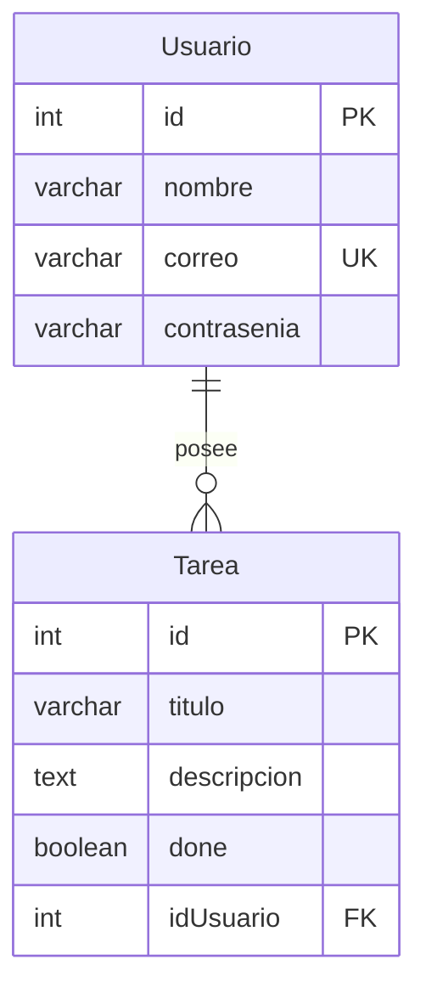
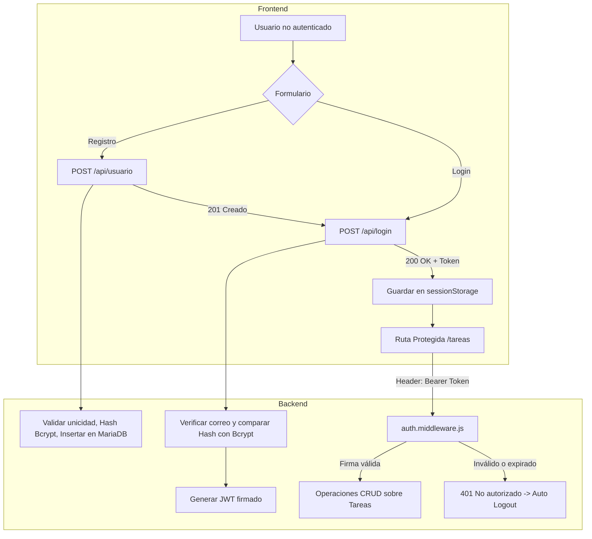

# 📋 Sistema de Gestión de Tareas (Full-Stack)

Proyecto full-stack para la gestión de tareas multiusuario con autenticación basada en tokens JWT, persistencia en MariaDB contenedorizada con Docker, backend modular en Node.js / Express bajo el estándar ECMAScript Modules (ESM) y frontend interactivo desarrollado con React 19, Tailwind CSS v4 y DaisyUI.

---

## 🚀 Arquitectura General del Proyecto

El repositorio está organizado en una arquitectura desacoplada que separa la base de datos, el servidor API y el cliente web:

```text
mariadbProg4/
├── 🐳 docker/              # Infraestructura contenerizada (MariaDB 11 en Docker Compose)
│   ├── docker-compose.yml
│   └── .env
├── ⚙️ backend/             # API REST con Express 5, MySQL2, JWT y Bcrypt
│   ├── src/
│   │   ├── config/         # Variables de entorno (.env)
│   │   ├── controller/     # Lógica de login, tareas (CRUD) y usuarios (registro)
│   │   ├── db/             # Pool de conexión, DDL (schema.sql) y seeds iniciales
│   │   ├── middleware/     # Autenticación JWT y manejador de errores global
│   │   ├── models/         # DAOs (Data Access Objects) para MariaDB
│   │   ├── routes/         # Enrutadores modulares (/login, /tareas, /usuario)
│   │   ├── services/       # Hashing Bcrypt, tokens JWT y wrapper de Express
│   │   └── app.js          # Arranque del servidor API
│   ├── .env
│   └── package.json
├── 💻 frontend/            # Cliente web interactivo (React 19 + Vite + Tailwind + DaisyUI)
│   ├── src/
│   │   ├── components/     # Componente Modal reutilizable para tareas
│   │   ├── hooks/          # useAxios (con token dinámico y auto-logout en 401)
│   │   ├── pages/          # Login, Registro, Seguridad (layout protegido) y Tareas
│   │   ├── services/       # Instancia de Axios y utilidades de sessionStorage
│   │   ├── App.jsx         # Raíz con Toaster de notificaciones y RouterProvider
│   │   └── main.jsx
│   ├── .env.local
│   └── package.json
└── 📄 README.md            # Documentación general del sistema
```

---

## 🛠️ Tecnologías y Herramientas

### Backend & Base de Datos
- **Entorno de ejecución:** Node.js (ES Modules, `"type": "module"`)
- **Gestor de paquetes:** `pnpm`
- **Framework web:** Express 5.x
- **Base de Datos:** MariaDB 11+ ejecutada en Docker
- **Conector BD:** `mysql2/promise` (Pool de conexiones asíncronas)
- **Seguridad:**
  - `bcrypt` para hashing seguro de contraseñas.
  - `jsonwebtoken` (JWT) para generación y validación de tokens de sesión.
- **Configuración y Entorno:** `dotenv`
- **Contenedores:** Docker & Docker Compose

### Frontend
- **Framework & Build Tool:** React 19 + Vite 8
- **Estilos & UI:** Tailwind CSS v4 + DaisyUI v5
- **Enrutamiento:** React Router DOM v7 (`createBrowserRouter`)
- **Cliente HTTP:** Axios (con interceptores Bearer y hook personalizado `useAxios`)
- **Feedback:** React Hot Toast
- **Compilador:** React Compiler activado mediante Babel & Rolldown

---

## 🗄️ Modelo de Base de Datos

El esquema se compone de dos tablas con integridad referencial y borrado en cascada:



- **`Usuario`**: Almacena credenciales de usuario con contraseña cifrada y correo único.
- **`Tarea`**: Representa cada tarea vinculada a un `Usuario` mediante clave foránea con borrado en cascada (`ON DELETE CASCADE`).

---

## 🔐 Autenticación y Flujo de Trabajo



---

## 📡 Endpoints de la API

La API se encuentra prefijada en `/api`:

### 1. Estado y Autenticación
| Método | Endpoint | Autenticación | Payload | Respuesta |
| :--- | :--- | :--- | :--- | :--- |
| `GET` | `/api/` | No | - | `ok` (200) |
| `POST` | `/api/login` | No | `{"correo": "...", "contrasenia": "..."}` | `{"usuario": "Nombre", "token": "..."}` |
| `POST` | `/api/usuario` | No | `{"nombre": "...", "correo": "...", "contrasenia": "..."}` | `{"usuario": "ok", "mensaje": "...", "token": "..."}` |

### 2. Tareas (Protegidas)
| Método | Endpoint | Autenticación | Payload / Parámetros | Descripción |
| :--- | :--- | :--- | :--- | :--- |
| `GET` | `/api/tareas` | `Bearer Token` | - | Lista las tareas del usuario logueado con datos de usuario. |
| `GET` | `/api/tareas/:id` | `Bearer Token` | `:id` (ID tarea) | Obtiene una tarea específica si pertenece al usuario. |
| `POST` | `/api/tareas` | `Bearer Token` | `{"titulo": "...", "descripcion": "..."}` | Crea una nueva tarea asociada al usuario autenticado. |
| `PATCH` | `/api/tareas/:id` | `Bearer Token` | `{"titulo": "...", "descripcion": "..."}` | Actualiza título y descripción de la tarea. |
| `POST` | `/api/tareas/completar/:id` | `Bearer Token` | `:id` (ID tarea) | Marca una tarea como finalizada (`done = 1`). |
| `DELETE` | `/api/tareas/:id` | `Bearer Token` | `:id` (ID tarea) | Elimina la tarea especificada si pertenece al usuario. |

---

## ⚙️ Guía de Puesta en Marcha

### 1. Requisitos Previos
- [Node.js](https://nodejs.org/) (versión 18 o superior)
- [pnpm](https://pnpm.io/)
- [Docker & Docker Compose](https://www.docker.com/)

---

### 2. Levantar la Base de Datos con Docker
Desde la raíz del proyecto:
```bash
cd docker
docker compose up -d
```
> MariaDB quedará disponible en el host en el puerto **`3307`** (redirigido internamente al `3306`), con usuario `root` y base de datos `tareas`.

---

### 3. Configurar y Arrancar el Backend
Desde la carpeta raíz del proyecto:
```bash
cd backend
pnpm install

# (Opcional) Ejecutar el seed para limpiar y poblar la base de datos con usuarios y tareas:
node src/db/seed.js

# Iniciar servidor Express en modo desarrollo:
pnpm run dev
```
> El servidor iniciará en el puerto **`3002`** (ej. `http://localhost:3002/api`).

---

### 4. Configurar y Arrancar el Frontend
En otra terminal, desde la raíz del proyecto:
```bash
cd frontend
pnpm install

# Verificar o configurar el archivo .env.local:
# VITE_APP_API_URL="http://localhost:3002/api"

# Iniciar cliente web en modo desarrollo:
pnpm run dev
```
> La aplicación estará disponible en `http://localhost:5173`.

---

## 👥 Datos de Prueba (Seeds)

El script `backend/src/db/seed.js` crea los siguientes usuarios de prueba:

| Usuario | Correo | Contraseña |
| :--- | :--- | :--- |
| Juan Pérez | `juan@correo.com` | `123456` |
| María Gómez | `maria@correo.com` | `abcdef` |

---

## 📌 Estado Actual del Proyecto

- [x] Contenedor Docker para MariaDB configurado y operativo.
- [x] Conexión mediante Pool asíncrono con `mysql2/promise`.
- [x] Modelos DAO para `Usuario` y `Tarea`.
- [x] Servicio de autenticación JWT y encriptación con Bcrypt.
- [x] Middleware de autorización por tokens Bearer.
- [x] Middleware centralizado de errores (`errores.middleware.js`) y rutas no encontradas (404).
- [x] Endpoint y controlador de registro de usuarios (`POST /api/usuario`).
- [x] CRUD completo de tareas en el backend (`GET`, `POST`, `PATCH`, `POST /completar/:id`, `DELETE /:id`).
- [x] Script de Seeds con datos de prueba hasheados.
- [x] Frontend interactivo completo en React 19 + Tailwind CSS v4 + DaisyUI:
  - [x] Vista de Login con feedback de errores y redirección.
  - [x] Vista de Registro de usuarios.
  - [x] Layout de rutas protegidas (`Seguridad.jsx`) con validación de sesión y logout.
  - [x] Panel de tareas con badges de estado, modal para crear y editar, botón de completar y botón de eliminar.
  - [x] Notificaciones Toast (`react-hot-toast`) y manejo de estados de carga/error.
- [ ] Validaciones de esquemas (ej. con Zod) en peticiones entrantes.
- [ ] Filtros, búsqueda y ordenamiento de tareas en el frontend.
- [ ] Pruebas unitarias e integración (Vitest / Supertest).

---

## 💡 Comandos de Git Útiles

```bash
# Subir cambios configurando upstream en la rama actual
git push -u origin <nombre-de-rama>

# Configurar git para vincular ramas remotas automáticamente
git config --global push.autoSetupRemote true

# Integrar cambios desde otra rama
git merge <rama-origen>
```
