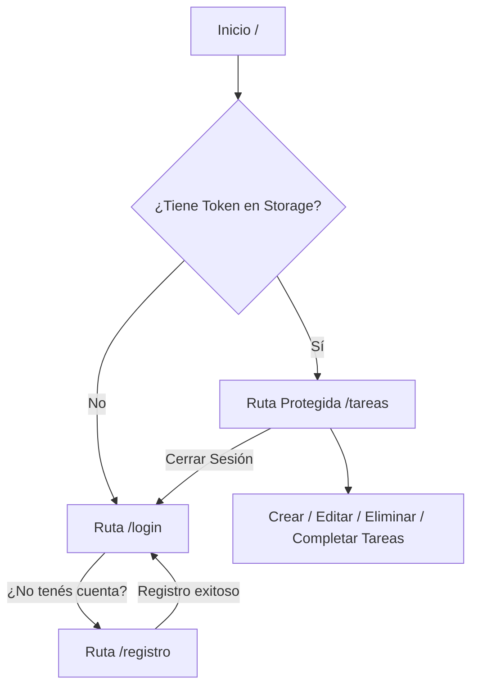

# 💻 Frontend - Tareas Plus

Cliente web moderno para la gestión integral de tareas de usuario, desarrollado con **React 19**, **Vite**, **Tailwind CSS v4** y componentes de **DaisyUI**. Diseñado para interactuar con la API REST de Node.js / Express y MariaDB.

---

## 🚀 Tecnologías y Librerías

- **Framework / Bundler:** [React 19](https://react.dev/) + [Vite](https://vite.dev/)
- **Estilos y Componentes:** [Tailwind CSS v4](https://tailwindcss.com/) + [DaisyUI v5](https://daisyui.com/)
- **Enrutamiento:** [React Router DOM v7](https://reactrouter.com/) (usando `createBrowserRouter`)
- **Peticiones HTTP:** [Axios](https://axios-http.com/)
- **Notificaciones Toast:** [React Hot Toast](https://react-hot-toast.com/)
- **Iconos:** [React Icons](https://react-icons.github.io/react-icons/)
- **Optimizador de Render:** [React Compiler](https://react.dev/learn/react-compiler) vía `@rolldown/plugin-babel`
- **Linter:** [Oxlint](https://oxc.rs/)

---

## 📁 Estructura del Proyecto

```text
frontend/
├── public/                 # Favicon y assets públicos estáticos
├── src/
│   ├── assets/             # Imágenes y recursos estáticos
│   ├── components/
│   │   └── Molda.jsx       # Componente Modal reutilizable (creación / edición de tareas)
│   ├── hooks/
│   │   ├── useAxios.jsx    # Custom hook para peticiones HTTP, manejo de loading, errores y cierre automático en 401
│   │   └── useStorage.jsx  # Hook auxiliar para almacenamiento
│   ├── pages/
│   │   ├── Login.jsx       # Vista de inicio de sesión
│   │   ├── Registro.jsx    # Vista de registro de nuevos usuarios
│   │   ├── Seguridad.jsx   # Layout de rutas protegidas y verificación de sesión activa
│   │   ├── Tareas.jsx      # Panel principal con CRUD completo de tareas
│   │   └── router.jsx      # Definición de rutas del navegador
│   ├── services/
│   │   ├── api.service.js           # Instancia de Axios con interceptor para Bearer Token
│   │   └── sessionStorage.service.js# Utilidades para almacenar, leer y remover tokens/datos
│   ├── App.css
│   ├── App.jsx             # Componente raíz con Provider de Rutas y Toaster
│   ├── index.css           # Directivas globales de Tailwind CSS y temas de DaisyUI
│   └── main.jsx            # Punto de entrada de la aplicación
├── .env.local              # Variables de entorno locales
├── .env.production         # Variables de entorno para producción
├── .oxlintrc.json          # Configuración de Oxlint
├── index.html
├── package.json
├── pnpm-lock.yaml
└── vite.config.js          # Configuración de Vite con plugins de React, Tailwind y Babel Compiler
```

---

## ✨ Funcionalidades Principales

### 1. Autenticación y Registro
- **Registro (`/registro`):** Formulario para crear un nuevo usuario (`nombre`, `correo`, `contrasenia`) conectado al endpoint `POST /api/usuario`. Muestra notificaciones de éxito o error con `react-hot-toast`.
- **Inicio de Sesión (`/login`):** Validación de credenciales contra `POST /api/login`. Guarda automáticamente el token JWT y datos de sesión en `sessionStorage`.
- **Rutas Protegidas (`Seguridad.jsx`):** Redirección inmediata a `/login` si no existe token válido en el almacenamiento de sesión.
- **Cierre de Sesión:** Botón accesible desde la barra de navegación superior que limpia el almacenamiento y redirige al login.

### 2. Panel de Tareas (`/tareas`)
- **Listado en tiempo real:** Visualización en cuadrícula responsiva (grid) de todas las tareas pertenecientes al usuario autenticado.
- **Badges de estado:** Indicador visual dinámico (*Completada* en verde / *Pendiente* en rojo).
- **Creación de Tarea:** Botón `+ Nueva Tarea` que despliega un modal con campos para título y descripción.
- **Edición de Tarea:** Posibilidad de modificar título y descripción de cualquier tarea existente mediante el modal interactivo (`PATCH /api/tareas/:id`).
- **Completar Tarea:** Acción rápida para marcar una tarea pendiente como finalizada (`POST /api/tareas/completar/:id`).
- **Eliminar Tarea:** Eliminación directa de la tarea con refresco automático de la lista (`DELETE /api/tareas/:id`).

---

## ⚙️ Configuración y Variables de Entorno

Crea o verifica el archivo `.env.local` en la raíz de `frontend/`:

```env
VITE_APP_API_URL="http://localhost:3002/api"
```

> **Nota:** La URL base debe coincidir con el puerto y prefijo en el que corre el servidor backend de Express.

---

## 🛠️ Comandos Disponibles

Ejecutar desde el directorio `frontend/`:

| Comando | Descripción |
| :--- | :--- |
| `pnpm install` | Instala las dependencias del frontend. |
| `pnpm run dev` | Inicia el servidor de desarrollo Vite con Hot Module Replacement (HMR). |
| `pnpm run build` | Compila la aplicación optimizada para producción en `dist/`. |
| `pnpm run preview` | Previsualiza localmente el build de producción. |
| `pnpm run lint` | Ejecuta el linter ultrarrápido Oxlint. |

---

## 🌐 Flujo de Rutas Frontend


